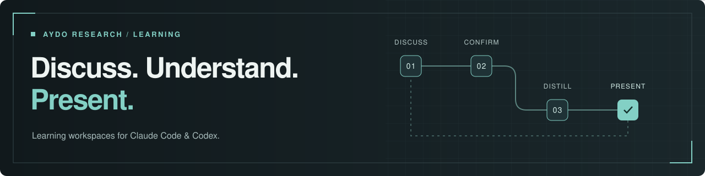
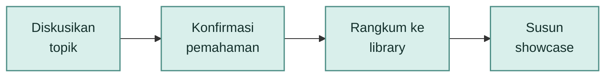

# AYDO Research

**Ruang belajar terstruktur yang dikerjakan bersama AI.**

AYDO Research menyimpan proses belajar teknis untuk kebutuhan kerja, dari diskusi awal sampai materi yang siap disampaikan. Setiap topik dikerjakan bersama **Claude Code** dan **Codex** dengan preferensi yang sama, sehingga hasilnya konsisten dari satu topik ke topik berikutnya.

[Pendekatan](#pendekatan) · [Alur belajar](#alur-belajar) · [Fokus](#fokus) · [Prinsip](#prinsip)

## Pendekatan

Setiap topik memiliki workspace sendiri. Preferensi umum, template, dan acuan produksi disimpan di satu baseline bersama, sehingga perubahan preferensi langsung berlaku di semua topik.

Manusia menentukan topik, menilai pemahamannya sendiri, dan menyetujui hasil akhir. AI membantu menjelaskan, mencatat, dan menyusun materi sesuai preferensi tersebut.

## Alur belajar

Topik baru masuk library setelah pemahamannya dikonfirmasi, bukan karena diskusinya sudah panjang. Showcase seperti presentasi, proposal, atau ebook disusun dari library.

## Fokus

| Area | Tujuan |
| :--- | :--- |
| **Pemahaman konsep** | Menjelaskan konsep, mekanisme, akar masalah, dan penanganannya secara runtut. |
| **Catatan diskusi** | Menyimpan pertanyaan, contoh, dan klarifikasi sebagai konteks yang bisa dirujuk kembali. |
| **Knowledge terkurasi** | Merangkum hasil yang sudah dipahami menjadi referensi ringkas dengan tautan ke sumbernya. |
| **Materi siap pakai** | Menyusun presentasi dan dokumen untuk audiens tertentu dari knowledge yang sudah dipahami. |

## Prinsip

- **Pemahaman sebelum kurasi.** Knowledge masuk library setelah pemahamannya dikonfirmasi.
- **Sumber yang jelas.** Klaim teknis memakai sumber primer, dan batas buktinya dinyatakan.
- **Preferensi yang sama.** Semua topik mengikuti satu baseline preferensi yang terus diperbarui.
- **Kendali pada pengguna.** Topik, penilaian pemahaman, dan persetujuan hasil tetap berada pada manusia.

---

AYDO Research · Discuss. Understand. Present.
